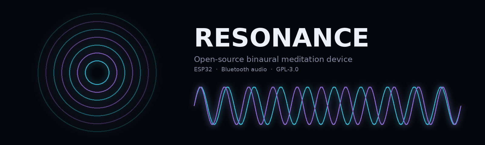
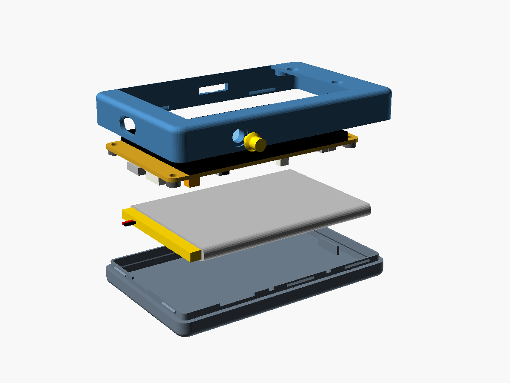

<p align="center"></p>

# Resonance

**Resonance is an open-source ESP32-based binaural meditation device with a
modular audio engine, customizable meditation sessions, and an experimental
platform for exploring physical randomness and meditation.**

It runs on an inexpensive 3.2-inch touchscreen board (the ESP32-2432S032C,
one of the "Cheap Yellow Display" family) and plays through Bluetooth
headphones: one tone in the left ear, a slightly different one in the right,
with noise and sound files from a microSD card mixed in, and timed sessions
that move the frequencies while you listen. It works offline; there is no
account, no cloud and no network connection.

Resonance is a binaural meditation device first, an audio laboratory second,
and — as a direction of research that is **not built yet** — a platform for
experiments with physical randomness ("Mindfield"). No effect on health or
mind is claimed for any frequency, preset or setting.

Firmware 0.12.0 · [GPL-3.0-or-later](LICENSE) · [Changelog](CHANGELOG.md)

## What it does today

Every item below is in the firmware and covered by the host test suite or a
measurement on the board. The second column says how far it has been checked
on the real device. "Heard / seen by the owner" means a person confirmed it;
"measured" means the device's own counters; "host tests only" means nobody
has yet judged it by ear or eye.

| Capability | Checked on the device |
|---|---|
| Stereo binaural tone: two sine oscillators, left at the primary frequency, right at primary + beat | Heard by the owner over a Bluetooth headset |
| Primary 20–1000 Hz and beat 0.5–40 Hz in 0.1 Hz steps, changed without clicks (phase-continuous glides) | Operated on the touchscreen; continuity proven in host tests |
| Frequency presets (14 primary, 9 beat) that set a starting value | Operated on the touchscreen |
| White, pink and brown noise | Measured (render time, stream); **not yet confirmed by ear** |
| Mixer with layer levels, master volume and a soft limiter | Measured: no dropouts in seven mixes |
| WAV and MP3 playback from microSD, streamed, never loaded whole | Two MP3 files heard by the owner |
| Bluetooth A2DP output: scan, choose, connect, reconnect | Used by the owner |
| Seven factory sessions (linear frequency sweeps, holds, end fade), a plain timer, pause / resume / stop | Started by the owner on the device |
| Touchscreen interface: HOME, FREQ, SND, SESS, SET | Used by the owner |
| Settings kept across restarts; audio never starts by itself | Measured over restarts |

### Implemented, awaiting verification by a person

These were added in firmware 0.9.0–0.9.6. They build, pass their host tests
and were exercised on the board through injected touches and serial
commands, but **nobody has yet listened to them or looked at their screens**:

- Phase offset and inversion per ear, phase sweep.
- Golden partials: two extra sines per ear at φ and φ² times the primary.
- Exponential and custom sweeps, transition-then-hold stages, progressive descent.
- User sessions of up to ten stages, built on the touchscreen and stored as text files on the card.
- Four mixer layers (tone, partials, noise, recording) with on/off, level and fade; fade between recordings.
- Breathing pacer (inhale, hold, exhale, hold) with optional modulation of the sound.
- Frequency sequences, with the Solfeggio set as an editable default.
- Resonance Lab: stereo width, interaural delay, bilateral alternation, A/B comparison with loudness matching.

### Mindfield: implemented, not yet used

Since 0.12.0 the firmware can collect raw output of a random-number source
on a fixed schedule, record it to the card, compute statistics on it and
show it through twelve pictures, with screens for set-up, results, history
and replay. It was run on the board through injected touches; **nobody has
yet looked at its screens, and no long baseline has been recorded.** It is
an instrument; nothing is claimed for it. See
[docs/MINDFIELD.md](docs/MINDFIELD.md).

### Not built

Wired audio output, battery measurement and any network function. See the
[roadmap](docs/ROADMAP.md).

## Hardware

| Part | Detail |
|---|---|
| Board | ESP32-2432S032C (Sunton), USB-C, capacitive touch |
| Processor | ESP32-WROOM-32 module (ESP32-D0WD-V3, dual core), 4 MB flash, **no PSRAM** |
| Display | 240 × 320, ST7789, SPI |
| Touch | GT911, I2C, polled |
| Storage | microSD on SPI (FAT32) |
| Audio out | Bluetooth Classic A2DP to headphones or a speaker. The board's small amplifier and speaker connector are not used |
| Power | USB-C, or a lithium cell on the board's battery connector |

Limits that shape the firmware: 4 MB of flash with one 3 MB application slot
and no over-the-air update; about 98 kB of free heap at rest and far less
while Bluetooth streams an MP3, so the decoder's buffers live in memory the
Bluetooth stack cannot use, nothing on the audio path allocates, and there
is no GUI framework. Details: [docs/HARDWARE.md](docs/HARDWARE.md).

## Software architecture

```
firmware/lib/resonance_core/   portable core: tone engine, mixer, limiter, noise,
                               resampler, WAV parser, sessions, presets, settings,
                               breathing pacer, sequences, Lab — no device headers
firmware/src/                  the device: Bluetooth output, file player, touchscreen
                               interface, SD card and settings storage, board pins
firmware/tests/                host tests of the core, built with the PC's compiler
firmware/tools/                host test runner, serial capture, serial file upload
hardware/                      enclosure: OpenSCAD sources, STL exports, previews
docs/                          requirements, decisions, architecture, DSP, hardware
```

The audio is pulled by the Bluetooth stack: its callback asks the engine for
a block, and the engine renders tone, partials, noise and whatever the file
player has decoded into a ring buffer. The render path never blocks,
allocates, logs or touches a file.

- [docs/ARCHITECTURE.md](docs/ARCHITECTURE.md) — modules, tasks, data flow.
- [docs/DSP.md](docs/DSP.md) — oscillators, noise, mixer, limiter, resampling.
- [docs/requirements/resonance.md](docs/requirements/resonance.md) — what the device must do, requirement by requirement.

## Building and testing

You need [PlatformIO](https://platformio.org/) (Core 6 or later), Python 3.9
or later, a C++17 compiler on the PC for the host tests (g++ or clang++),
and the board on a USB-C cable.

```bash
# host tests of the portable core (no board needed): 19 programs
python3 firmware/tools/host_tests.py

# build the firmware (the first build compiles the ESP-IDF libraries and
# takes several minutes)
cd firmware
pio run

# build and flash over USB
pio run -t upload

# talk to the device (115200 baud); type "help" for the command list
pio device monitor
```

Put sound files under `/RESONANCE/AUDIO/` on a FAT32 microSD card (WAV or
MP3; folders are shown as folders). No sound files are included in this
repository. More in [firmware/README.md](firmware/README.md).

## Enclosure and CAD

The repository includes the enclosure as parametric OpenSCAD source, STL
exports of every part, and preview images rendered from those sources, for
each revision. **Only version 1 is recorded as printed and fitted to the
board; v3, v4 and v4 slim render as valid solids but have not been printed,
and for v2 no print is recorded.** Status per
revision, dimensions' sources and how to regenerate the files:
[hardware/README.md](hardware/README.md).

<p align="center"></p>

## Roadmap

- **Exists:** everything in the two lists above.
- **Next for audio:** verification by ear of the 0.9 features, device
  management for Bluetooth, transport controls for the player.
- **Resonance Lab:** exists as one screen; to be refined once it has been
  listened to.
- **Mindfield:** a research concept under development — collecting raw
  output of physical random-number sources during meditation and analysing
  it honestly. Implemented since 0.12.0 and not yet verified by a person.
  No ability to influence randomness has
  been demonstrated or is claimed. See
  [docs/MINDFIELD.md](docs/MINDFIELD.md).

Full list: [docs/ROADMAP.md](docs/ROADMAP.md).

## Contributing

Bug reports, measurements on other boards of the family, prints of the
enclosure and code are welcome. See [CONTRIBUTING.md](CONTRIBUTING.md).

## License

Copyright © 2026 Pacmanfan and the Resonance contributors.

Resonance — firmware, tools, documentation and the hardware design files in
this repository — is free software under the **GNU General Public License,
version 3 or (at your option) any later version**. See [LICENSE](LICENSE).

In short: you may use, study, change and share it, including commercially.
If you distribute it or something built from it — for example a device with
this firmware — you must pass on the same freedoms: provide the complete
corresponding source under the GPL and keep the notices. There is no
warranty.

The firmware is built with third-party libraries that keep their own
licences; one of them, the Helix MP3 decoder, needs attention before
binaries are distributed. See
[THIRD_PARTY_LICENSES.md](THIRD_PARTY_LICENSES.md).
