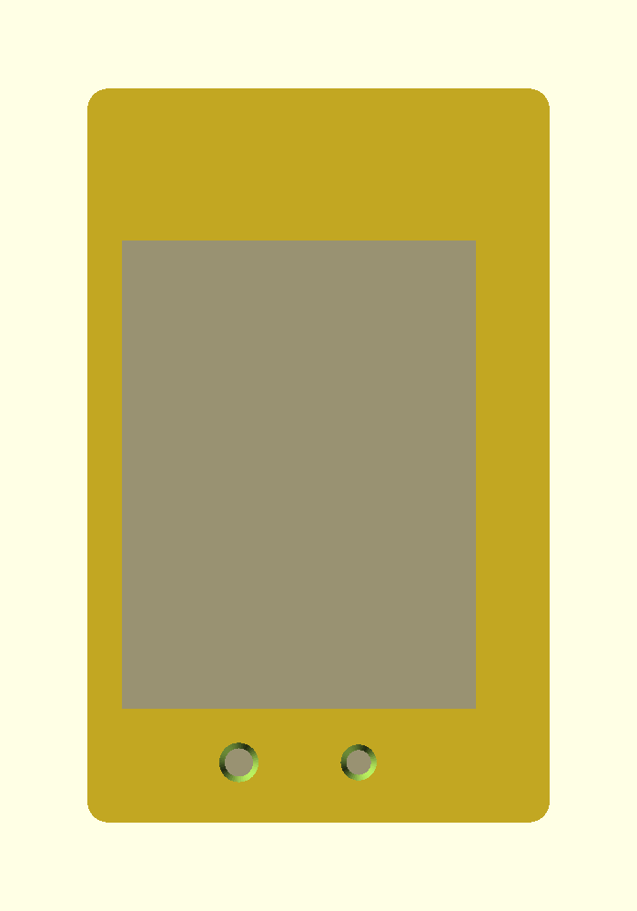
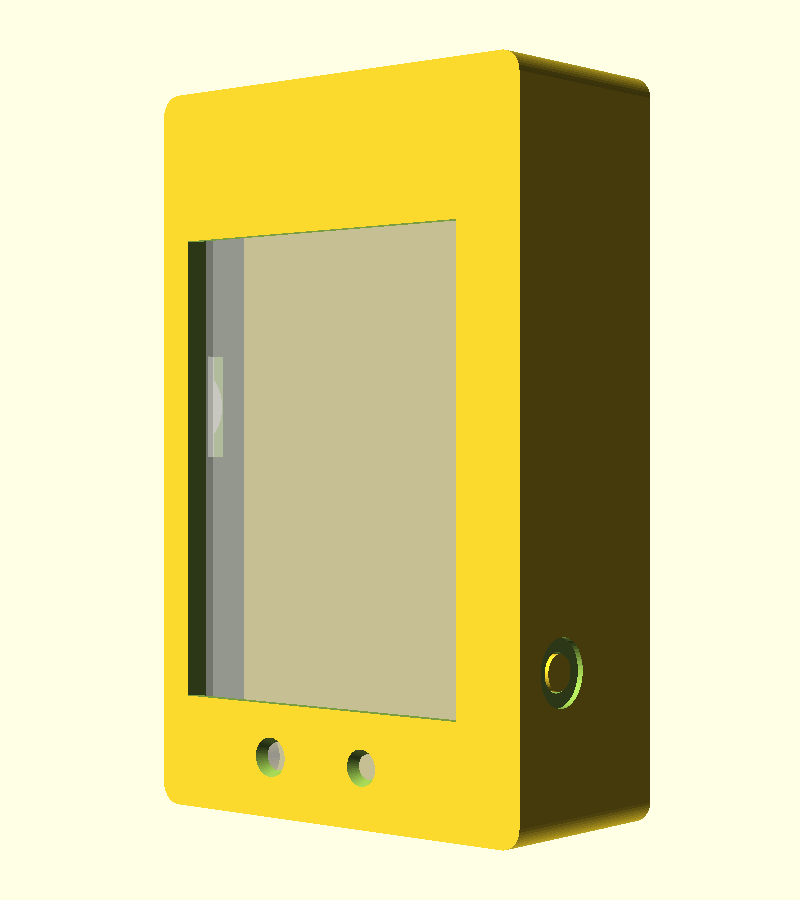
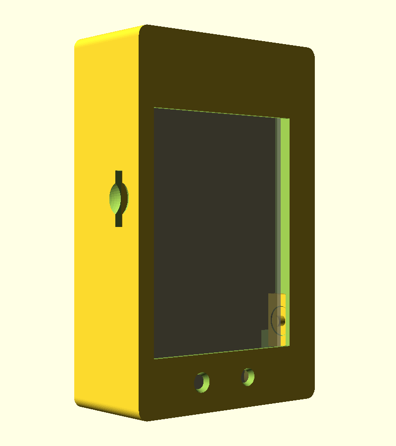
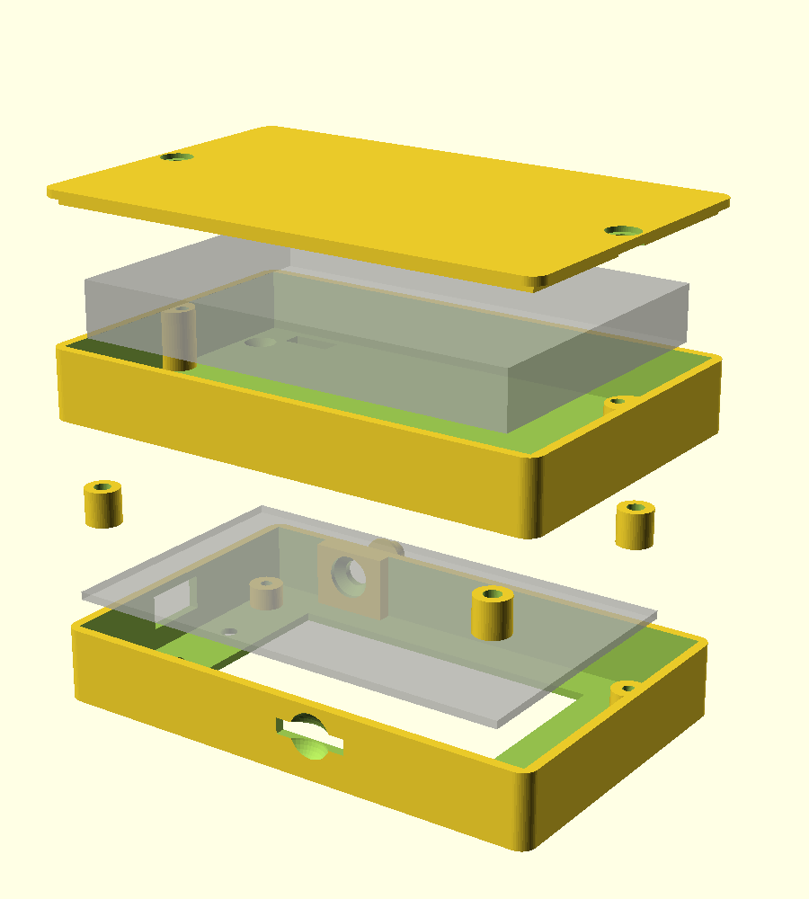
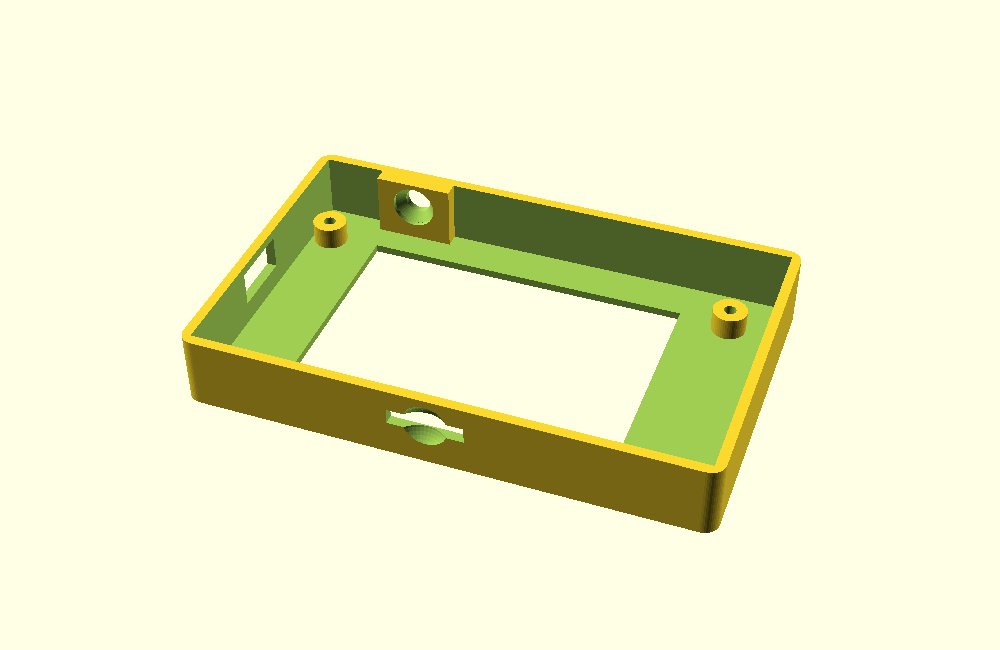
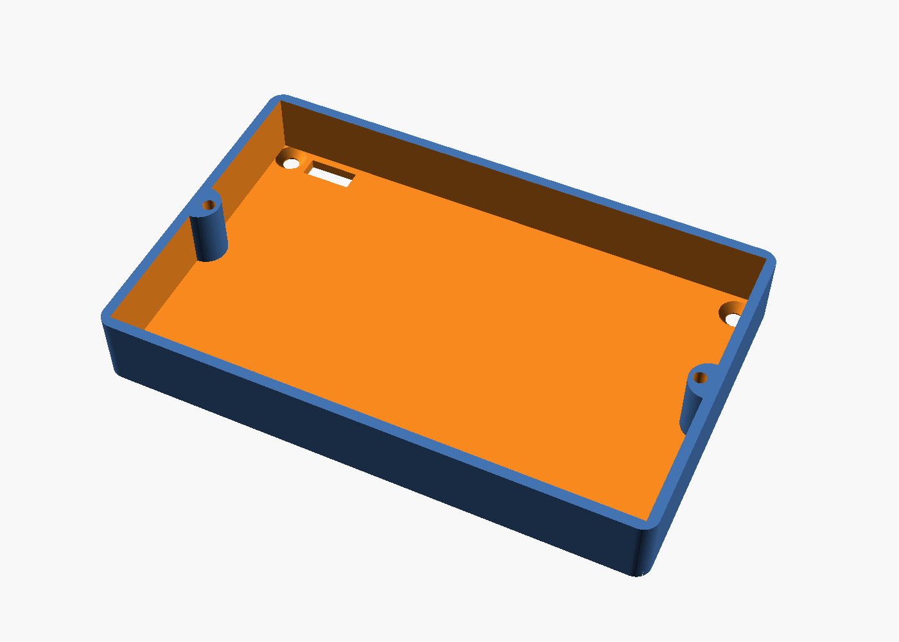

# Resonance enclosure

**Requirement:** RES-HW-007 (`docs/requirements/resonance.md`)
**Source:** `resonance_case.scad` (OpenSCAD, parametric)
**Status:** draft v0. Every part renders as a valid solid. **Nothing has been
printed, and the openings are placed by guess**: the board must be measured
first (table below).

A case for the ESP32-2432S032C with a 90 × 60 × 11 mm LiPo cell behind it.
The cell is larger than the board (93.7 × 55 mm), so the case is sized by the
cell: **104 × 65.6 × 30.2 mm** with the present numbers.

As held: upright in the left hand, screen towards you, USB-C at the bottom.
The microSD slot is on the left edge, the power button low on the right
edge, and the RGB LED and the light sensor look out through two windows
below the screen.








The assembled back is closed: the only holes in it are the two for the lid
screws. The holes visible in the picture of the battery tray are inside the
case. They are in the tray's floor, which is the divider between the cell and
the board: four countersunk holes for the screws that hold the stack
together, and a slot for the battery lead. The cell lies on top of them and
the lid covers the cell.

## Parts

All parts print flat on the bed without supports.

| Part | Count | What it is |
|---|---|---|
| `front` | 1 | Bezel shell: screen window, four bosses the board rests on, openings for USB-C, the microSD card and the power button |
| `spacer` | 4 | Tubes between the back of the board and the tray |
| `tray` | 1 | Battery tray. Its 2 mm floor is the divider between the cell and the board's components |
| `lid` | 1 | Back cover over the cell |
| `button` | 1 | Separate push-button for the board's power switch: a shaft that shows in a finger dish on the side of the case, a lip that sits in a seat inside the wall and keeps it captive, and a stem that presses the switch |

Access: USB-C (bottom end), microSD (left edge, with a scallop for a
fingernail), power button (right edge, low). Two windows in the front let
the RGB LED shine out and light reach the sensor. The expansion connectors,
the speaker connector and the reset and boot buttons are covered, as asked.

## Hardware

| Item | Count | Notes |
|---|---|---|
| M3 × 14 countersunk screw | 4 | Through tray floor, spacer and board into the front bosses, cutting their own thread. No longer than 16 mm |
| M3 × 6 screw | 2 | Lid to tray |
| Thin foam or tape | — | Between cell and lid if the cell is loose |

## Assembly

1. Put the button into its hole from the inside of the front shell, shaft
   first, so that its lip lies in the seat. The board then keeps it in.
2. Lay the board, screen down, on the four bosses.
3. Stand a spacer on each mounting hole.
4. Put the tray on, feed the battery lead through the slot in its floor, and
   drive the four countersunk screws. Their heads must sit flush.
5. Plug the battery in **only after checking its polarity with a meter**
   (`docs/architecture/HARDWARE.md`, section 8), lay the cell in the tray,
   and screw the lid on.

## Measure before printing

These are the values in the "TO BE MEASURED" block of the source. The
defaults are guesses, not data (RES-PROC-002). A caliper is enough.

| Parameter | What to measure | Default |
|---|---|---|
| `pcb_t` | Board thickness | 1.6 |
| `lcd_h` | Front of the board to the top of the screen glass | 4.6 |
| `rear_h` | Tallest part on the back of the board, plus 1 mm | 7.0 |
| `lcd_offset_x` | Board edge at the USB-C end to the edge of the lit screen area | 14.4 |
| `lcd_offset_y` | Board edge on the microSD side to the edge of the lit screen area | 3.2 |
| `usb_y` | Centre of the USB-C socket, from the board edge on the microSD side | 27.5 |
| `usb_z` | Centre of the USB-C socket above the back of the board | 1.7 |
| `sd_x` | Centre of the microSD slot, from the USB-C end | 56.0 |
| `led_x`, `led_y` | Centre of the RGB LED, from the USB-C end and from the microSD-side edge | 6.0, 19.0 |
| `ldr_x`, `ldr_y` | Centre of the light sensor, the same way | 6.0, 36.0 |
| `btn_x` | Centre of the power button, from the USB-C end | 20.0 |
| `btn_z` | Centre of the power button above the back of the board | 1.5 |
| `btn_travel` | Not a measurement: free play between the button's stem and the switch. Lower it if the button rattles, raise it if the switch is held down | 0.5 |
| `bat_lead_x` | Battery connector, from the USB-C end | 12.0 |
| `bat_l`, `bat_w`, `bat_t` | The cell, exactly | 90, 60, 11 |

Also check, because the design assumes it:

- that the **power button is on the long side opposite the microSD slot**,
  and points sideways (a button that points backwards needs a different
  plunger);
- that the microSD slot and the USB-C socket are on the back of the board;
- that the **RGB LED and the light sensor are on the screen side** of the
  board. If they are on the back, the windows belong in the lid or a side
  wall instead, and a light pipe may be needed;
- that nothing on the board stands in the way of the four bosses at the
  mounting holes.

From the manufacturer's drawing, and not in need of measuring: board
93.7 × 55.0 mm; four 3.2 mm holes, 3.5 mm in from the edges; lit screen area
64.8 × 48.6 mm.

## Rendering

```bash
openscad -o front.stl  -D 'part="front"'  resonance_case.scad
openscad -o spacer.stl -D 'part="spacer"' resonance_case.scad
openscad -o tray.stl   -D 'part="tray"'   resonance_case.scad
openscad -o lid.stl    -D 'part="lid"'    resonance_case.scad
openscad -o button.stl -D 'part="button"' resonance_case.scad
```

`part="assembly"` shows everything together with the board and the cell as
ghosts. The STL files are not kept in the repository.

## Suggested first print

Print only `front`, in draft quality, and lay the board in it: that shows at
once whether the window, the USB-C opening, the card slot and the button
hole are where the board has them. Correct the numbers, then print the rest.

## The power button

The wall is 3 mm thicker on the inside where the button goes through. From
outside in: a 9.5 mm finger dish, 0.8 mm deep; the 5 mm shaft, standing
0.4 mm above the floor of the dish so that it can be felt but does not
catch; a 45-degree shoulder and an 8.5 mm lip in a matching seat; and a
3.2 mm stem that ends 0.5 mm short of the switch on the board. The button
prints standing on its shaft, without supports.

Its position (`btn_x`, `btn_z`) is a guess until the board is measured, and
the design assumes that the switch faces sideways, out of the long edge.

## Known limits of this draft

- The two halves are aligned only by the four screws; there is no lip
  between front shell and tray.
- The screen window is a plain opening sized to the lit area. A capacitive
  glass larger than that will sit behind the bezel, which is intended, but
  its outline has not been measured.
- No stand. A bedside stand can be added to the lid.
- The cell is charged at about 0.4 A by the board (reported by a reseller,
  not measured), so a cell of this size takes many hours to fill.

## Existing designs

None found for this board with an internal battery bay. The closest, for
reference: "Case for ESP32 LCD" by mfu on Printables (model 1232481, STEP
files reported), its stand remix by MR (model 1315032), and
"ESP32-2432S032C-I" by Peter Jakob on MakerWorld (model 1066899). Their
licences were not verified.
