# Resonance enclosure: design history

> **Historical record.** This is the design log that was kept as
> `hardware/case/README.md` while the enclosure was being developed, moved
> here unchanged except for the image links. Where it names a `.scad` file,
> that file is now in [`../openscad/`](../openscad/); where it says
> `README.md`, it means this file. Its pictures are the ones made at the
> time, now in [`../previews/original/`](../previews/original/). The current
> overview, the exported STL files and the validation results are in
> [`../README.md`](../README.md). The sentence "The STL files are not kept in
> the repository" below is no longer true: they are in [`../stl/`](../stl/).


**Requirement:** RES-HW-007 (`docs/requirements/resonance.md`)
**Sources:** `resonance_case_v4.scad` (the case), `resonance_case_v4_slim.scad` (the same for the 5.75 mm cell), `resonance_case_v3.scad`, `resonance_case_v2.scad`, `resonance_case.scad` (earlier versions), `esp32_2432s032.scad` (reference
model of the board), `battery.scad` (reference model of the cell). OpenSCAD,
parametric.
**Status:** version 4 (`resonance_case_v4.scad`) is the current design; it
renders as valid solids and **has not been printed**. Version 1
(`resonance_case.scad`) was printed once on 2026-11-18: its USB-C, microSD
and button openings lined up with the board. The sections from "How it goes
together" to "Hardware" and "The power button" below describe version 1.

## Version 4 slim

`resonance_case_v4_slim.scad`: version 4 for the operator's second cell
(2026-11-21), which has the same length and width, 90 × 60 mm, and is
**5.75 mm thick** instead of 11 mm. The file includes version 4 and changes
that one number (`bat_t`). The outside is 106 × 67 × **19.85 mm** (version
4: 25.1). The front shell and the button are the same parts as in version 4;
only the back shell differs, 6.85 mm high instead of 12.1. The room above
the cell (1.5 mm, `bat_gap`) and between board and cell (5.5 mm, `comp_h`)
is unchanged. The cell's thickness is the operator's figure; its length and
width are still the approximate ones. Renders as valid one-piece solids;
not printed.

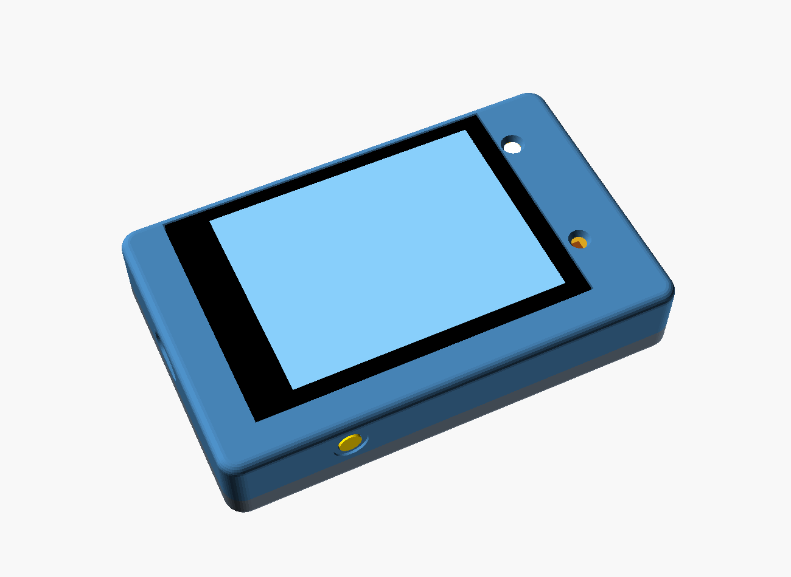
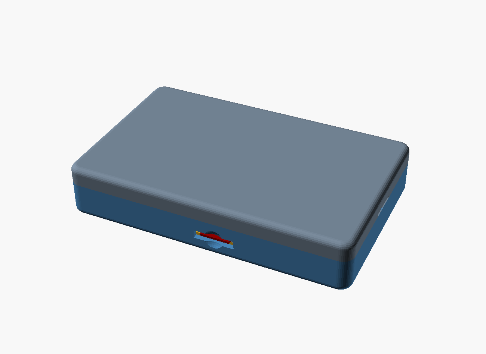
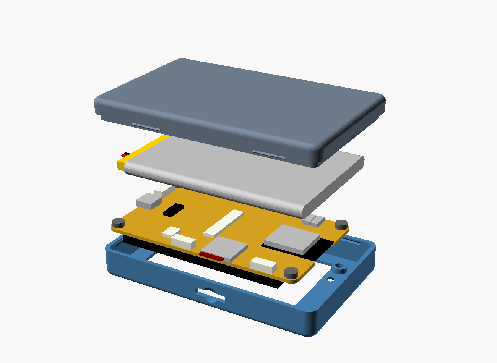
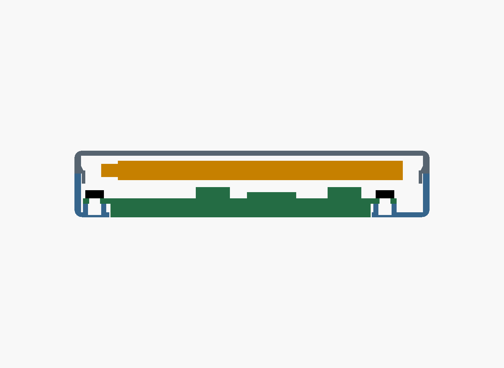

## Version 4

`resonance_case_v4.scad`: version 3 with side walls of **2.0 mm** instead of
1.5 mm (operator: the faces are thick enough, the walls were not). Front and
back faces stay 1.5 mm. The inside is unchanged; the outside is
106 × 67 × 25.1 mm. Everything said of versions 3 and 2 below applies. Not
printed.


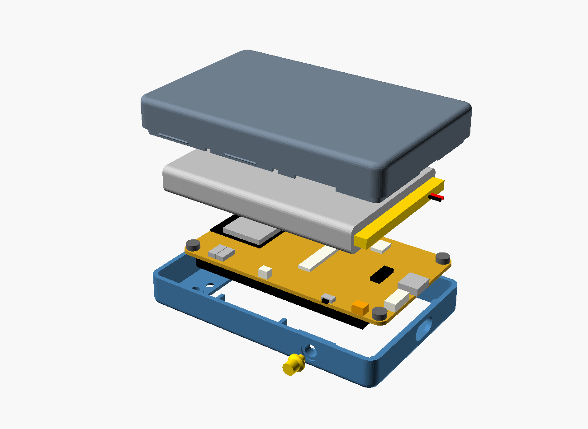

## Version 3

`resonance_case_v3.scad`: version 2 with the window cut to the glass as the
operator measured it on 2026-11-18, **77.6 × 55.0 mm, 4.0 mm above the
board** (version 2 had 76.6 × 54.4 from the drawing). The glass is as wide
as the board, so the window runs on to the wall on the microSD side: the
bezel there is the 1.5 mm wall alone. Everything else is as in version 2,
described below. Not printed.

Changed afterwards (operator, same day): the USB-C opening is a hole with
round ends, 13 × 7 mm, in the front shell alone, so the board goes in USB-C
end first at a slant (its socket stands 1.1 mm over the board's edge). The
radii are larger: 4.5 mm at the corners (`corner_r`) and 2.2 mm at the edges
of the two faces (`edge_r`). The inside corners are now rounded to 3.0 mm;
the board's own corner radius is an estimate (3.5 mm), so if the board does
not go into the corners, reduce `corner_r`. On the microSD side the rounded
edge leaves the wall about 0.1 mm below the glass.

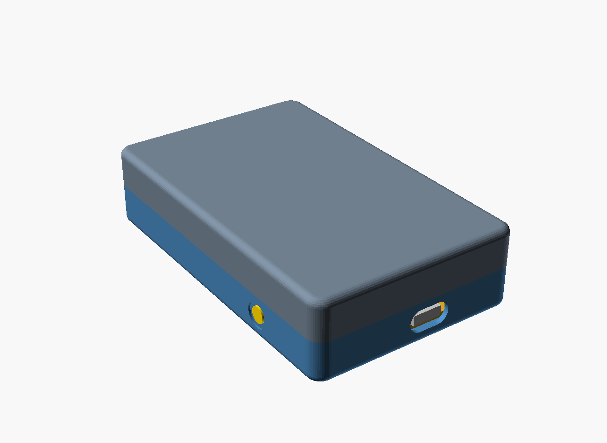

Still not measured: where the glass sits along the board's length. It is
centred on the outline in the drawing, with 0.4 mm of room at each end; if
the glass does not enter the window, change `glass_x`.


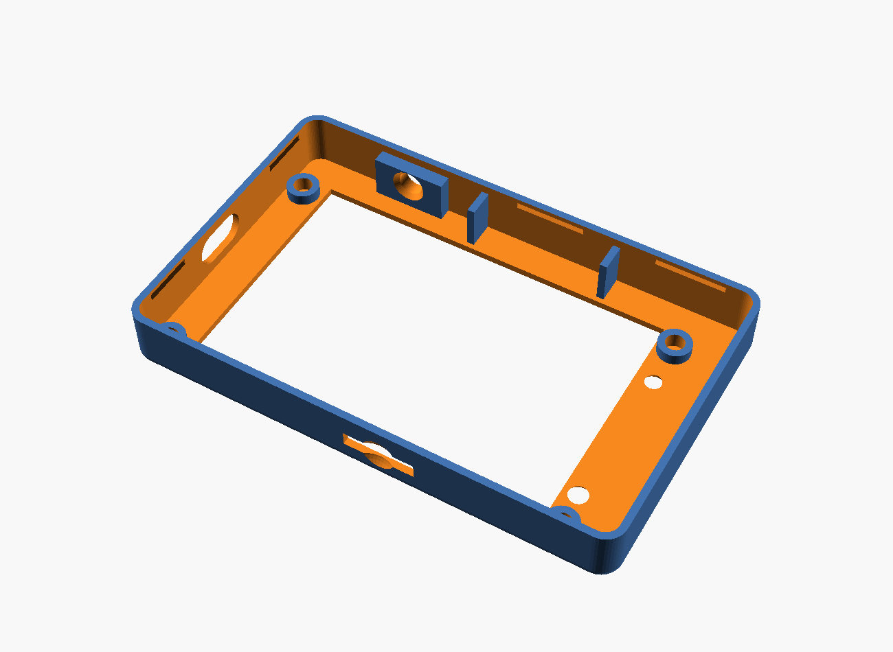

## Version 2

Made from the operator's notes on the printed version 1.

| Asked for | What version 2 does |
|---|---|
| Glass flush with the case | The window is cut to the outline of the glass (76.6 × 54.4 mm plus 0.4 mm each side) and the board sits so that the glass ends level with the face |
| Shell 0.5 mm thinner | Walls, front face and back face are 1.5 mm |
| Holes for inserts | The four bosses have 4.0 mm holes, 3.4 mm deep, for M3 heat-set inserts 3 mm long |
| Two pieces that snap together | `front` and `back`; a 3 mm skirt on the back goes inside the front's walls and seven ridges click into grooves. No tray, no lid, no case screws |
| No divider | Removed. The cell lies 5.5 mm behind the board; a sheet of paper or foam goes between |
| Button 0.5 mm longer | The stem now reaches the switch's actuator (`btn_travel = 0`) |
| Rounded top and bottom | The edges of the front and back faces have a 1.2 mm radius (`edge_r`) |

Outer size **105 × 66 × 25.1 mm** (version 1: 106 × 67 × 30.3).

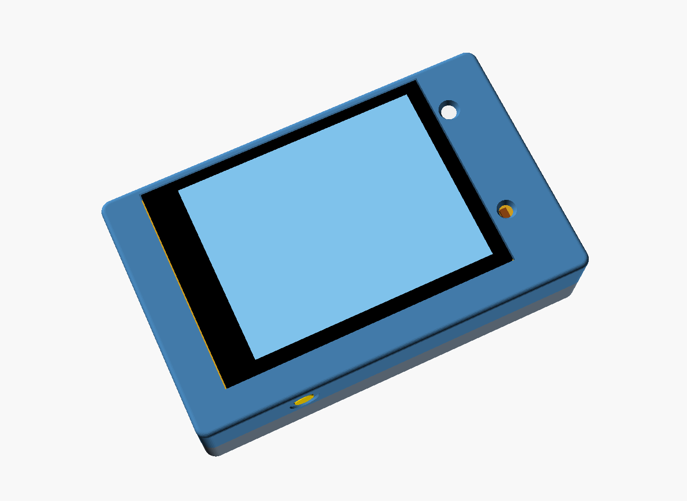
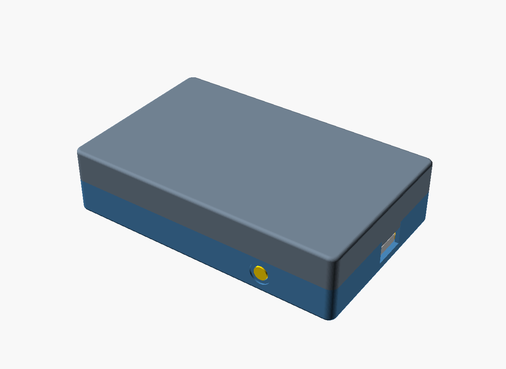
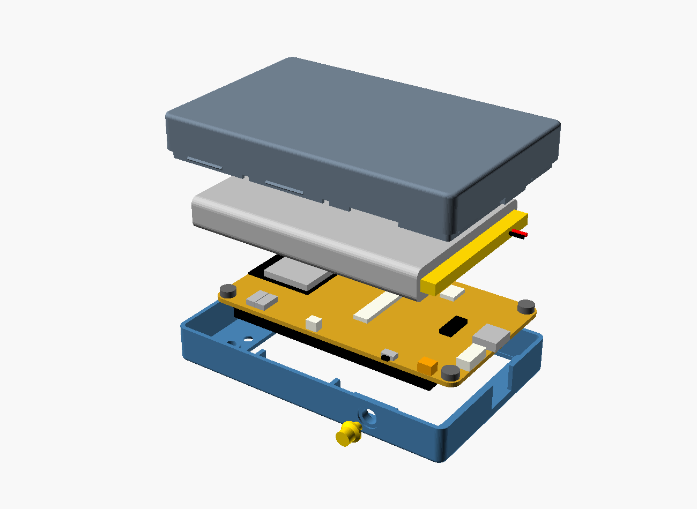
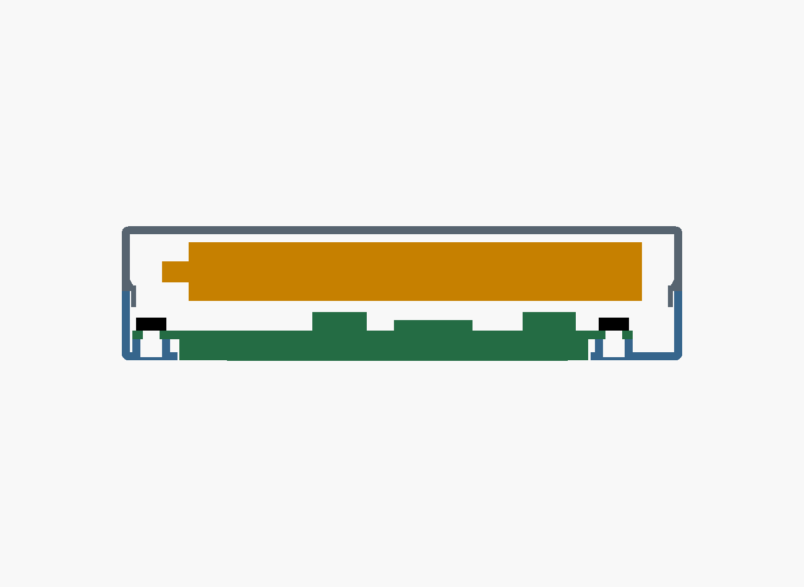
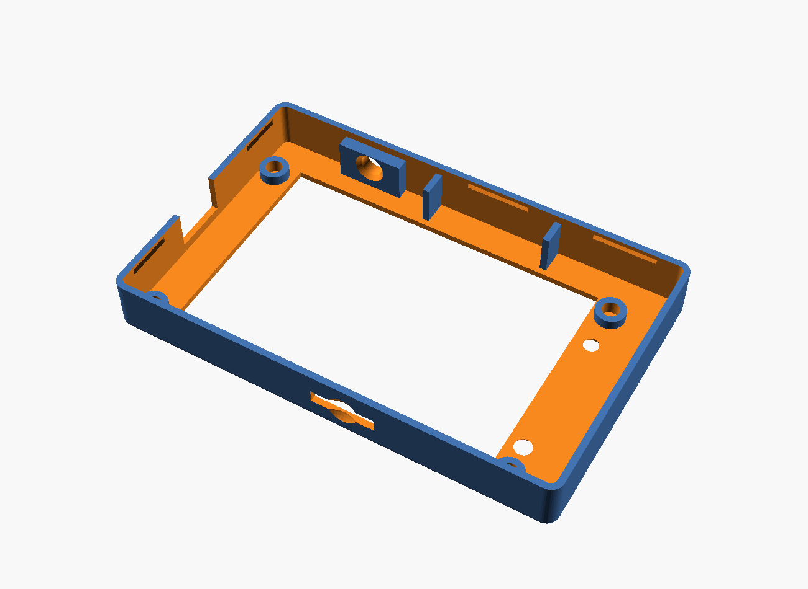
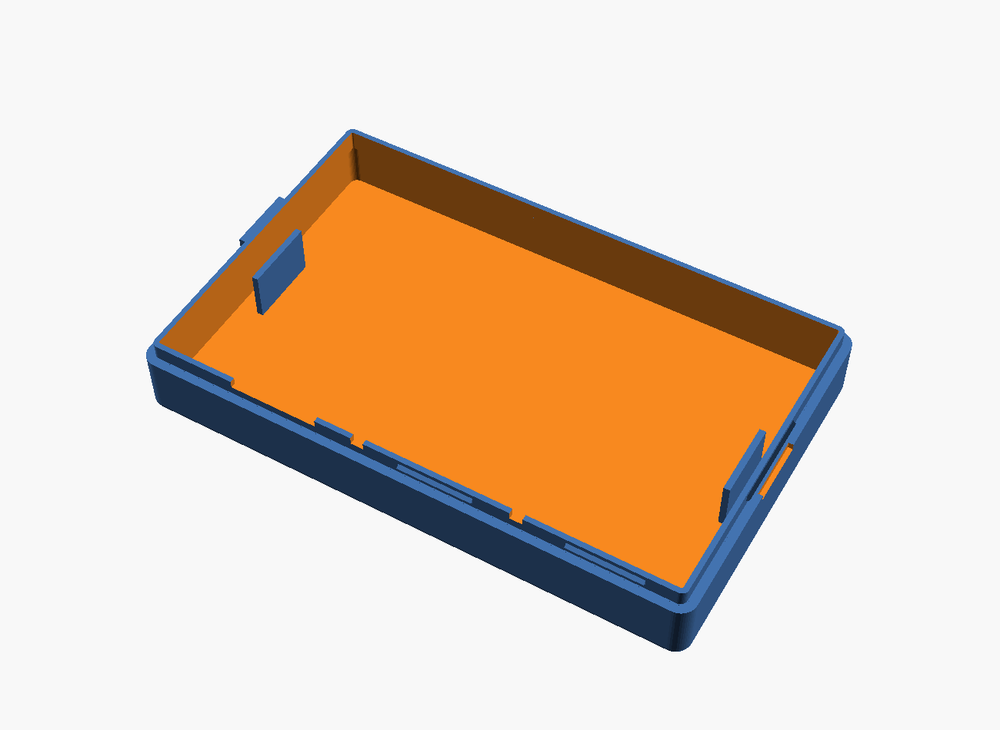

**Parts:** `front`, `back`, `button`. All print without supports: the front
on its face, the back on its back face, the button on the end that shows.

**Hardware:** four M3 heat-set inserts (3 mm long, about 4.2 mm outside) and
four M3 × 4 pan-head screws for the board. Nothing else.

**Assembly:** press the inserts into the bosses; put the button in from the
inside; lay the board in, glass into the window, and drive the four screws;
plug in the cell (polarity checked with a meter first), lay the barrier
sheet and the cell on the board; press the back on until it clicks. To open,
twist a coin in the slot at the seam at the end away from USB-C.

**Not known until printed:**

- The outline of the glass and its height above the board (`glass_x`,
  `glass_l`, `glass_y`, `glass_w`, `lcd_h`) are from the drawing and from
  other cases. If the glass is larger than 76.6 × 54.4 it will not enter the
  window; if `lcd_h` is not 4.0 it will stand proud or sit low.
- How hard the snap holds. `snap_grip` (0.4 mm) is the number to change, by
  0.1 mm at a time.
- The cell rests on two ribs and the button's pad on one side and on the
  board's parts, through the foam, on the other.
- On the microSD side the bezel beside the glass is only about 2 mm wide.

```bash
openscad -o front.stl  -D 'part="front"'  resonance_case_v2.scad
openscad -o back.stl   -D 'part="back"'   resonance_case_v2.scad
openscad -o button.stl -D 'part="button"' resonance_case_v2.scad
```

## Version 1

A case for the ESP32-2432S032C with a 90 × 60 × 11 mm LiPo cell behind it,
106 × 67 × 30.3 mm. As held: upright in the left hand, screen towards you,
USB-C at the bottom; microSD slot on the left edge, power button low on the
right edge, RGB LED and light sensor above the screen.

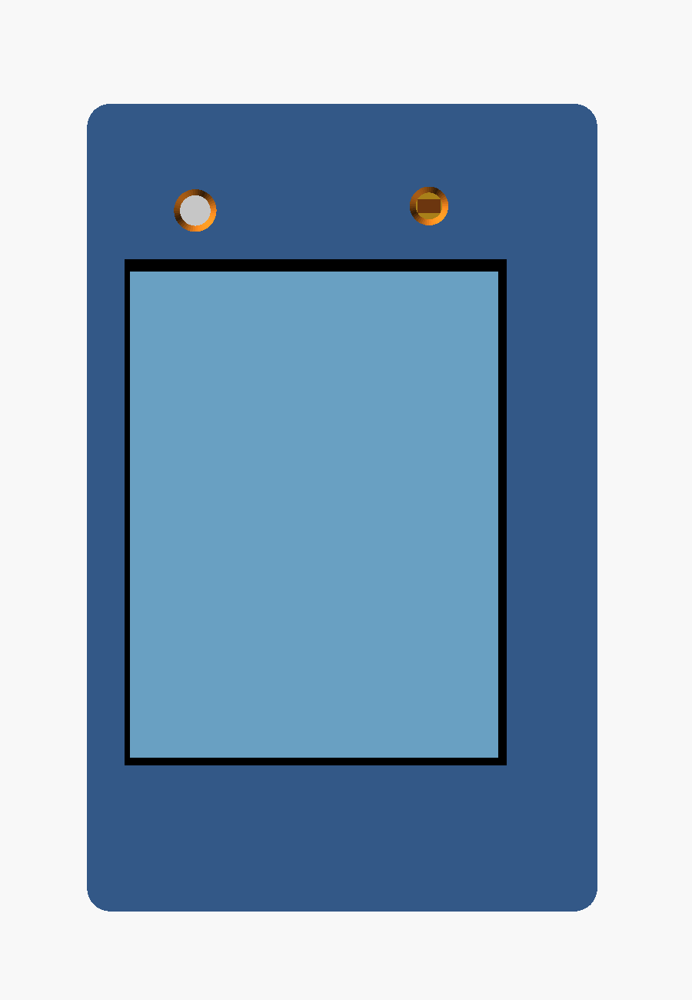
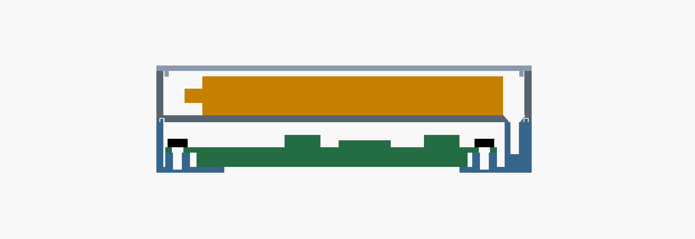
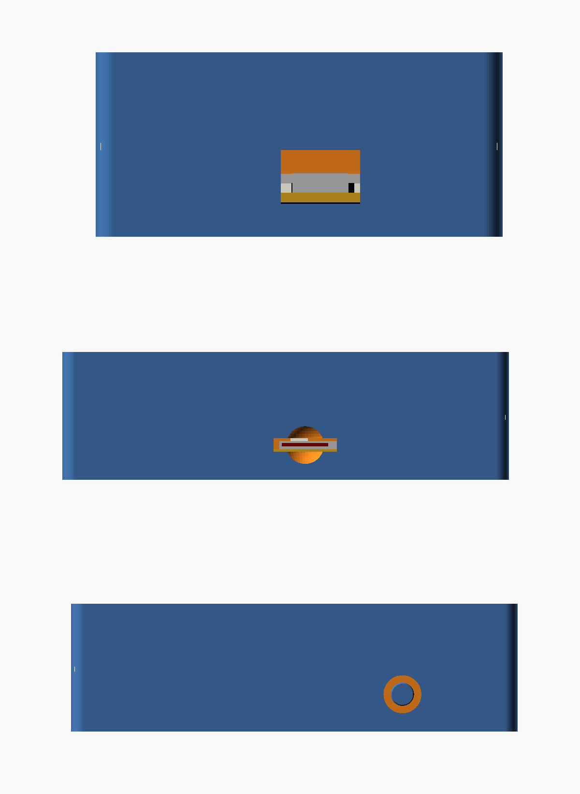
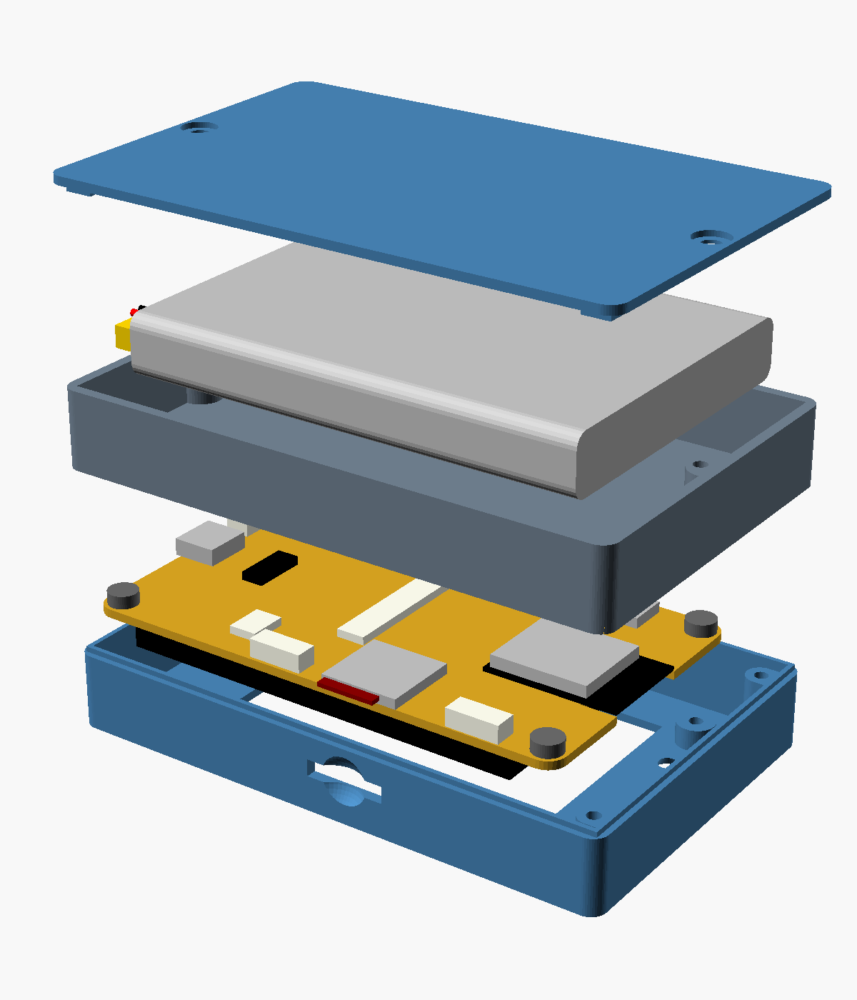
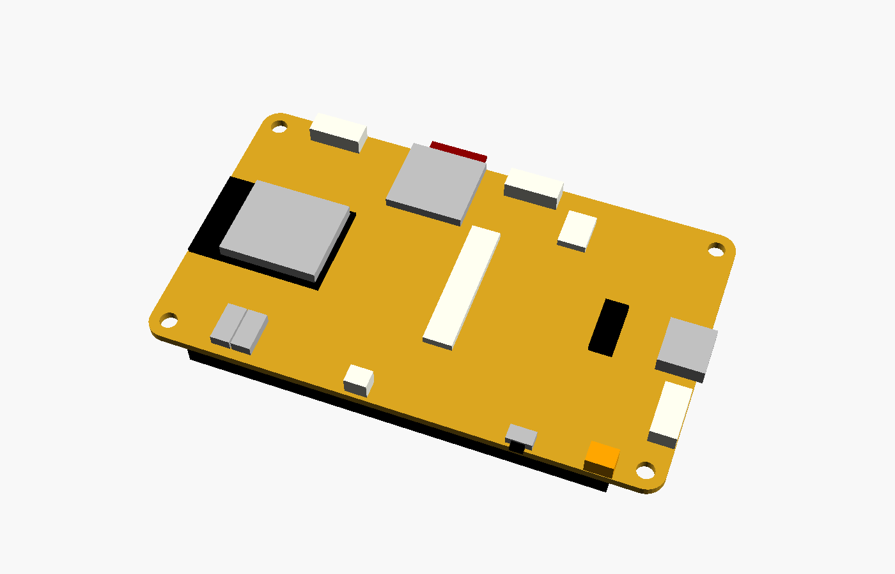

## How it goes together

The board is held to the front shell by four short screws into the bosses at
its mounting holes, and by nothing else: **no post stands behind the
board**. The tray is a separate part whose 2 mm floor lies between the
board's components and the cell. It is held to the front shell by three
screws that are beside the board in the front shell and beside the cell in
the tray, so **no screw and no screw head is under or beside the cell's
face** (draft v0 had four countersunk heads under the cell). A rim on the
front shell's walls fits a groove in the tray's floor and keeps the fourth
corner closed: there is no room for a column at the USB-C end on the
microSD side, where the board reaches both walls.

## The cell's room

| Direction | Free space with a 90 × 60 × 11 cell |
|---|---|
| Each end | 6 mm (lid screws, tray screws, the leads) |
| Each side | 1.5 mm |
| Above, to the lid | 1.5 mm |
| Below | Flat floor, no openings under the cell except the slot for its lead, which is beside it |

The lid's rim is only at the two ends, so that it does not press on the
cell's edges. A pouch cell grows thicker with age; 1.5 mm is room for that
and for a strip of foam. "Approximately 90 × 60 × 11" is all that is known
of the cell: measure it, including the taped strip at the lead end, and set
`bat_l`, `bat_w`, `bat_t` in `battery.scad`.

## The openings

| Opening | Size | Notes |
|---|---|---|
| USB-C | 13 mm wide notch, open to the top of the wall and closed by the tray | Room for the moulding of a plug, not only the socket. Being open at the top, it lets the board drop straight in although its socket stands 1.1 mm over the board's edge |
| microSD | 15 × 3.2 mm slot with a scallop for a fingernail | The card's centre line is about 1.2 mm off the socket's; the slot is centred on the card |
| Power button | 5 mm shaft in a 9 mm finger dish | See below. The source checks that the dish stays inside the wall |
| RGB LED, light sensor | 4 mm and 3.5 mm windows, widening outwards | In the front face, above the screen |

## Parts

All parts print flat on the bed without supports.

| Part | Count | What it is |
|---|---|---|
| `front` | 1 | Bezel shell: screen window, four bosses for the board, three columns for the tray, the openings |
| `tray` | 1 | Battery tray. Its floor is the divider between the cell and the board |
| `lid` | 1 | Back cover over the cell |
| `button` | 1 | Separate push-button: shaft, lip that keeps it captive, stem that reaches the switch |

## Hardware

| Item | Count | Notes |
|---|---|---|
| M3 × 6 pan-head screw | 4 | Board to the front bosses, cutting their own thread |
| M3 × 10 countersunk screw | 3 | Tray to the front shell |
| M3 × 6 screw | 2 | Lid to tray |
| Thin foam | — | Between cell and lid if the cell is loose |

## Assembly

1. Put the button into its hole from the inside of the front shell, shaft
   first, so that its lip lies in the seat.
2. Lay the board, screen down, on the four bosses and drive the four short
   screws.
3. Plug the battery lead into the board **only after checking its polarity
   with a meter** (`docs/architecture/HARDWARE.md`, section 8). The lead goes through
   the slot in the tray's floor, so feed it through before plugging it in.
4. Put the tray on and drive its three screws.
5. Lay the cell in the tray and screw the lid on.

## Where the board's numbers come from

No 3D model of the bare board was found (searched 2026-11-18: Printables,
Thingiverse, Cults, GitHub; GrabCAD and MakerWorld only through a web
search). `esp32_2432s032.scad` is built from:

| Mark | Source | Good for |
|---|---|---|
| D | The manufacturer's dimension drawing, mirrored at `github.com/kpeeem/3.2inch_ESP32-2432S032` (`3-Structure_Diagram/3.2.jpg`) | Printed numbers: outline 93.7 × 55.0, holes 3.2 mm at 3.5 mm from the edges |
| P | The same drawing (front) and the vendor's rendering of the back shown on `espboards.dev/esp32/cyd-esp32-2432s032`, scaled from the mounting holes | Positions in the plane, about ±0.3 mm. A rendering, not a photograph |
| C | Two published cases, their files parsed: Printables models 1315032 and 832282 | Independent check of USB-C, microSD, power switch, RESET, BOOT and three connectors, within about 0.5 mm; the only source for heights, and then only as upper bounds |

The back-view picture in the `platformio-espressif32-sunton` repository is of
a different board (its silkscreen reads ESP32-2432S024) and was not used.

## Confirm before printing

A caliper is enough. Positions are from the USB-C end (`_x`) and from the
board's edge on the microSD side (`_y`).

| Parameter | What it is | Value | From |
|---|---|---|---|
| `lcd_h` | Front of the board to the top of the screen glass | 4.0 | C, upper bound. **Measure** |
| `pcb_t` | Board thickness | 1.6 | Usual value. **Measure** |
| `rear_h` | Room behind the board | 7.0 | The parts need about 4.0 (C); the rest is for the battery plug and the button |
| `lcd_offset_x`, `lcd_offset_y` | Lit screen area | 17.5, 3.2 | P; ±0.5 along the length |
| `usb_y`, `usb_z` | USB-C socket | 27.5, 1.65 | P, C |
| `sd_x` | Centre line of the card | 55.1 | C |
| `btn_x`, `btn_z` | Power switch | 24.8, 1.6 | P, C |
| `led_x`, `led_y` | RGB LED | 89.5, 11.7 | P, C |
| `ldr_x`, `ldr_y` | Light sensor | 90.1, 42.4 | P, C |
| `bat_lead_x` | Battery connector | 10.7 | P only |
| `bat_l`, `bat_w`, `bat_t` | The cell | 90, 60, 11 | The operator, "approximately" |

Not known from any source: the thickness of the screen with its touch
glass, the outline of that glass (one case leaves 79.4 mm for it, the
drawing shows 76.6), every component height, the board's corner radius.

**The power switch.** The vendor's rendering draws it as a small switch with
its actuator pointing out of the long edge opposite the microSD slot, and
labels it a battery switch. The case assumes a push-button pressed sideways.
If it is a slide switch, the printed button has to become a slider.

**The battery plug** leaves the board sideways, towards the button-side
wall, 10.7 mm from the USB-C end. There are 6 mm between the board and that
wall for the plug and the bend of its wires: check that with the real lead.

## Rendering

```bash
openscad -o front.stl  -D 'part="front"'  resonance_case.scad
openscad -o tray.stl   -D 'part="tray"'   resonance_case.scad
openscad -o lid.stl    -D 'part="lid"'    resonance_case.scad
openscad -o button.stl -D 'part="button"' resonance_case.scad
```

Each part comes out lying on the bed the way it should be printed: the
front shell on its face, the tray on its floor, the lid on its outer face,
the button standing on its shaft. No supports.

`part="assembly"` shows everything together with the board and the cell as
ghosts, `"exploded"` pulls the stack apart, and `"section"` draws the cut
along the length. Open `esp32_2432s032.scad` or `battery.scad` by itself to
look at the board or the cell alone. The STL files are not kept in the
repository.

## Suggested first print

Print only `front`, in draft quality, and lay the board in it: that shows at
once whether the window, the USB-C notch, the card slot, the button hole and
the two small windows are where the board has them. Correct the numbers,
then print the rest.

## The power button

The wall is 3 mm thicker on the inside where the button goes through. From
outside in: a 9 mm finger dish, 0.8 mm deep; the 5 mm shaft, standing 0.4 mm
above the floor of the dish; a 45-degree shoulder and an 8.5 mm lip in a
matching seat; and a 3.2 mm stem that ends 0.5 mm (`btn_travel`) short of
the switch's actuator, which is taken to stand 0.6 mm over the board's edge
(`btn_overhang`, from a picture: measure it). If the device switches by
itself or the button has no feel, these two numbers are the ones to change;
the button is an 8 mm part and quick to reprint. The button prints standing on its shaft, without supports.

## Known limits of this draft

- Three tray screws, not four; the fourth corner relies on the rim.
- The screen window is a plain opening sized to the lit area, and it is not
  centred on the case, because the board sits against the microSD wall.
- The LED and the sensor are 4 mm behind their windows, with no light pipe.
- No stand.
- The cell is charged at about 0.4 A by the board (reported by a reseller,
  not measured), so a cell of this size takes many hours to fill.

## Existing designs

None found for this board with an internal battery bay. For reference:
Printables models 1315032 (MR, with STEP files) and 832282 ("CYD 3.2 case"),
Thingiverse thing 6290847 (machanzar), a case on Cults with a separate
button part, and MakerWorld model 1066899 (Peter Jakob). Their licences were
not verified; only dimensions were read from the two Printables files.
